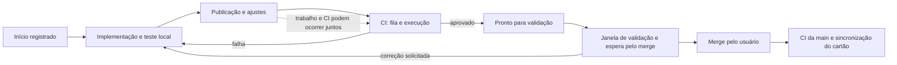

# Fluxo de valor — três entregas da Sprint 2

Refs [#23](https://github.com/MatheusSCristo/EntregaAi/issues/23).
Coleta em 25/11/2026; horários em São Paulo (UTC−03:00), durações corridas.
Fonte reproduzível: [snapshot](evidencias/sprint-02/fluxo-coleta.json), com comentários,
eventos de revisão, merges e checks. Dependência: [registro de tempos #16](tempos-kanban-sprint-2.md).

## Fluxo observado



O recorte calculado termina no merge. O CI da main e o fechamento administrativo
ocorrem depois e não são somados ao lead time deste mapa. A criação das issues
tampouco é o início: o planejamento de toda a sprint ocorreu em lote.

## Método e qualidade dos dados

Foram selecionadas intencionalmente #13 (Compose), #14 (CI) e #21 (WhatsApp fake),
duas entregas curtas e uma que atravessou o fim de semana. Não é amostra aleatória
nem média de todas as entregas da sprint.

- **Lead time operacional:** início de trabalho informado até o merge do PR.
  O início tem precisão de minuto; não representa criação→fechamento de issue.
- **Processamento estimado:** janela entre esse início e o marco de entrega da
  sessão. Inclui implementação, testes, documentação, administração e CI paralelo.
  É uma aproximação da janela de trabalho, potencialmente superestimada;
  **não existe medição de esforço líquido** que permita calcular eficiência real.
- **Marco de entrega:** evento ReadyForReview no #13; comentário de entrega no
  #14 e #21. Nestes dois últimos, há respectivamente 5 e 29 segundos de registro
  administrativo após o evento de revisão, mantidos na janela da sessão.
- **Janela de validação:** marco de entrega→merge. Os timestamps são verificáveis,
  mas o intervalo pode conter revisão ativa; não prova ociosidade contínua.
- **Eficiência estimada:** processamento estimado ÷ lead time × 100. O resultado
  deve sempre ser identificado como estimativa. Eficiência de trabalho real: indisponível.
- **CI:** união dos intervalos startedAt→completedAt dos checks aprovados
  preservados na coleta. Jobs simultâneos contam uma vez. Esse tempo está contido
  na sessão e não é somado novamente ao lead time nem tratado como espera exclusiva.
  Fila anterior ao início dos jobs não é reconstruída como esforço.

As fases implementação/testes/documentação não têm cronometragem individual;
ficam agregadas na janela estimada da sessão. Não foram inventados tempos por fase.

## Fontes dos marcos

| Item | Início informado | Marco de entrega da sessão | Merge |
| --- | --- | --- | --- |
| [#13](https://github.com/MatheusSCristo/EntregaAi/issues/13) | [04/11 14:32, aproximado](https://github.com/MatheusSCristo/EntregaAi/issues/13#issuecomment-6637481448) | [04/11 14:52:06, ReadyForReview do PR #28](https://github.com/MatheusSCristo/EntregaAi/pull/28) | [04/11 19:55:47](https://github.com/MatheusSCristo/EntregaAi/commit/d4f5074f57de77c3346d6a0a5d171762e1fed6a0) |
| [#14](https://github.com/MatheusSCristo/EntregaAi/issues/14) | [06/11 09:53, aproximado](verificacao-s2-02.md#registro-de-execução) | [06/11 09:59:03, comentário de entrega](https://github.com/MatheusSCristo/EntregaAi/issues/14#issuecomment-6685370235) | [06/11 10:14:46](https://github.com/MatheusSCristo/EntregaAi/commit/6b1a962d5414f8c213cea13eceaf4ce0a7ce3617) |
| [#21](https://github.com/MatheusSCristo/EntregaAi/issues/21) | [20/11 11:31, aproximado](https://github.com/MatheusSCristo/EntregaAi/issues/21#issuecomment-7042121208) | [20/11 11:47:24, comentário de entrega](https://github.com/MatheusSCristo/EntregaAi/issues/21#issuecomment-7042482134) | [23/11 09:05:27](https://github.com/MatheusSCristo/EntregaAi/commit/478ccaf7a6b7cd0587973c5cef9873535141e2bc) |

O snapshot contém os eventos ReadyForReview de #28 (14:52:06), #29 (09:58:58)
e #37 (11:46:55). No #13 houve substituição do PR #27 pelo #28 por renomeação
da branch, documentada na issue; não são duas entregas.

## Processamento, espera e eficiência por item

| Item | Janela de processamento estimada | CI observado, incluído na sessão | Janela de validação→merge | Lead time operacional | Eficiência estimada |
| --- | --- | --- | --- | --- | --- |
| #13 | 20 min 06 s | 1 min 56 s | 5 h 03 min 41 s | **5,396389 h** (5 h 23 min 47 s) | **6,2079%** |
| #14 | 6 min 03 s | 1 min 26 s | 15 min 43 s | **0,362778 h** (21 min 46 s) | **27,7948%** |
| #21 | 16 min 24 s | 1 min 30 s | 69 h 18 min 03 s | **69,574167 h** (69 h 34 min 27 s) | **0,3929%** |

Os checks coletados dão tempo de execução de jobs; o documento de tempos
também registra janelas de runs, que incluem fila e finalização. Os valores
diferem porque os pontos de início/fim e a população de checks diferem.
O relato transitório de CI em fila no #13 não demonstra bloqueio durante toda
a sessão: as execuções preservadas terminaram aprovadas.

### Médias, em horas corridas

| Indicador | Resultado |
| --- | --- |
| Lead time médio dos três itens | **25,111111 h** (25 h 06 min 40 s) |
| Processamento estimado médio | **0,236389 h** (14 min 11 s) |
| Janela média de validação | **24,874722 h** (24 h 52 min 29 s) |
| Média aritmética das três eficiências estimadas | **11,4652%** |
| Eficiência estimada agregada, soma do processamento ÷ soma do lead time | **0,9414%** |

As duas eficiências respondem a perguntas diferentes: a média aritmética dá o
mesmo peso aos três itens; a agregada é dominada pela entrega de ciclo longo.
Não escolher uma delas para sugerir uma produtividade que não foi medida.

## Gargalo e melhoria proposta

As janelas entre entrega e merge somam **74 h 37 min 27 s**, ou **99,0586%**
das **75 h 20 min** do recorte. Isso localiza a maior permanência no fluxo em
validação/merge; não mede tempo improdutivo nem atribui a espera a uma pessoa.
A #21, de sexta a segunda-feira, concentra a maior parcela. O calendário explica
parte do intervalo; não há logs para separar revisão ativa de espera dentro dele.
Os jobs de CI observados somam somente **4 min 52 s**, já incluídos nas sessões.

**Proposta:** Matheus combinar janelas de revisão e merge às 09h e 17h em dias
úteis, confirmar capacidade de revisão antes de puxar um item e evitar entregar
um lote sem janela combinada antes de um fim de semana. Revisão e checks
continuam obrigatórios; não usar merge automático para atingir a meta.

- Responsável: **Matheus Senas de Cristo**.
- Prazo para instituir a rotina: **30/11/2026**.
- Métrica-alvo: nos **próximos três PRs**, janela ReadyForReview→merge
  **≤24 horas corridas para os três**, acompanhada também por mediana e máximo.
  É uma meta proposta, ainda não validada; se o calendário impedir, registrar
  o motivo e rever a meta, sem trocar silenciosamente a unidade para horas úteis.
- Registro complementar: início/fim de trabalho e de cada pausa por item,
  para substituir a estimativa de processamento por medição líquida no futuro.

## Reprodução e limites de comparação

Na raiz, sem rede nem dependências adicionais:

```powershell
node --check scripts/fluxo-de-valor.cjs
node scripts/fluxo-de-valor.cjs
node scripts/fluxo-de-valor.cjs docs/evidencias/sprint-02/fluxo-coleta.json
```

As duas execuções produzem o mesmo JSON. O script valida a ordem dos marcos,
os checks aprovados, as somas e as sobreposições do CI. O snapshot preserva
fontes originais; os inícios aproximados foram transcritos dos relatos, não
deduzidos de commits ou da movimentação atual das colunas.

Esta definição difere do lead time de commit→CI da integração de
[métricas DORA adaptadas](metricas-02.md) e de criação→fechamento de issue da
Sprint 1. Não calcular redução percentual entre essas definições.
O mapa é uma fotografia de três itens concluídos, não uma medição de produção,
de produtividade pessoal, de toda a sprint nem do teste externo do README.
